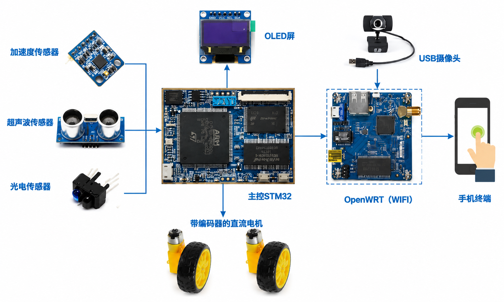
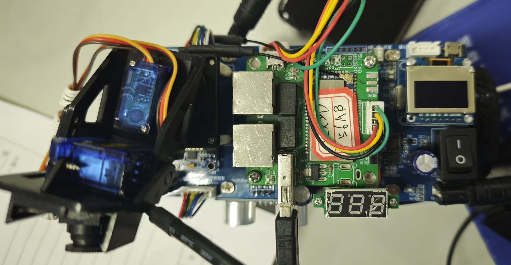

# 🤖 BalanceCar-STM32

基于 STM32F103 的两轮自平衡小车，采用串级 PID 控制，支持蓝牙遥控、WiFi 遥控和超声波自动避障三种模式。

<p align="center">
  
</p>

<p align="center">
  
</p>

## ✨ 功能一览

- 🧠 **MPU6050 + DMP 姿态解算** — 直接输出 Pitch/Roll/Yaw，无需自己写卡尔曼滤波
- 🎯 **串级 PID 控制** — 直立环 PD + 速度环 PI + 转向环 PD，三环串级
- 📡 **三种控制模式** — 蓝牙遥控 / WiFi 遥控 / 超声波自动避障，可动态切换
- 🖥️ **OLED 显示** — SSD1306 0.96 寸，实时显示模式状态
- 🎥 **舵机云台** — 双 SG90 舵机，水平 + 俯仰可遥控调节
- 📱 **手机 APP 遥控** — 蓝牙/WiFi 双模遥控，支持方向控制、速度切换、舵机调节

<p align="center">
  
</p>

## 📚 文档导航

| 文档 | 内容 |
|------|------|
| [硬件手册](docs/HARDWARE.md) | 物料清单、引脚分配、电路连接说明 |
| [控制算法](docs/CONTROL.md) | PID 原理、参数表、调参指南 |
| [通信协议](docs/PROTOCOL.md) | 蓝牙/WiFi/超声波协议详解 |
| [软件架构](docs/ARCHITECTURE.md) | 任务调度、模块说明、源码结构 |
| [调试记录](docs/BUGFIX.md) | 典型 Bug 定位与修复记录 |

## 🛠️ 快速上手

### 硬件准备

- STM32F103RC 最小系统板（信盈达或兼容板）
- MPU6050 六轴传感器
- 两个带 11 线编码器的减速电机
- H 桥电机驱动模块
- JDY-33 蓝牙模块 / WiFi 串口模块
- HC-SR04 超声波模块
- SSD1306 0.96" OLED
- 2× SG90 舵机

> 详细接线见 [硬件手册](docs/HARDWARE.md)

### 编译与烧录

1. 安装 [Keil MDK-ARM 5](https://www.keil.com/download/)
2. 打开 `firmware/project/BalanceCar.uvprojx`
3. 确认目标芯片为 STM32F103RC
4. 编译（F7）→ 烧录（F8）
5. 使用 ST-Link 或 J-Link 下载

### 遥控方式

| 模式 | 切换指令 | 遥控方式 |
|------|----------|----------|
| 蓝牙模式 (LYMODE) | 蓝牙发送 `0x0D` | 手机蓝牙 APP |
| WiFi 模式 (WXMODE) | 蓝牙发送 `0x0E` | WiFi 串口透传 |
| 避障模式 (BZMODE) | 蓝牙发送 `0x11` | 自动运行 |

## 📁 项目结构

```
BalanceCar-STM32/
├── docs/                              # 项目文档
│   ├── HARDWARE.md                    # 硬件手册
│   ├── CONTROL.md                     # 控制算法
│   ├── PROTOCOL.md                    # 通信协议
│   ├── ARCHITECTURE.md                # 软件架构
│   ├── BUGFIX.md                      # 问题排查与修复记录
│   └── images/                        # 图片资源
├── firmware/                          # STM32 固件源码
│   ├── project/                       # Keil MDK 工程文件
│   ├── startup/                       # 启动文件
│   ├── STM32F10x_StdPeriph_Driver/    # STM32 标准外设库
│   └── user/                          # 用户代码
│       ├── main.c                     # 主程序入口
│       └── api/                       # 模块驱动
│           ├── control.c/h            # PID 控制（核心）
│           ├── motor.c/h              # 电机 PWM 驱动
│           ├── encoder.c/h            # 编码器测速
│           ├── ble.c/h                # 蓝牙通信
│           ├── wifi.c/h               # WiFi 通信
│           ├── sr04.c/h               # 超声波避障
│           ├── steer.c/h              # 舵机云台
│           ├── oled.c/h               # OLED 显示
│           ├── MPU6050/               # MPU6050 + DMP 库
│           │   └── eMPL/              # InvenSense eMPL
│           ├── LED.c/h                # LED 指示
│           ├── delay.c/h              # 延时与系统滴答
│           └── usart1.c/h             # 串口调试
├── .gitignore
└── README.md
```

## ⚙️ PID 参数速查

| 环路 | 类型 | Kp | Kd / Ki |
|------|------|------|---------|
| 直立环 | PD | 230 | 0.6 |
| 速度环 | PI | -0.5 | -0.0025 |
| 转向环 | PD | -20 | -0.7 |

> 调参方法见 [控制算法 → 调参指南](docs/CONTROL.md#8-调参指南)

## 📄 License

MIT License — 欢迎提交 issue 与改进建议。
