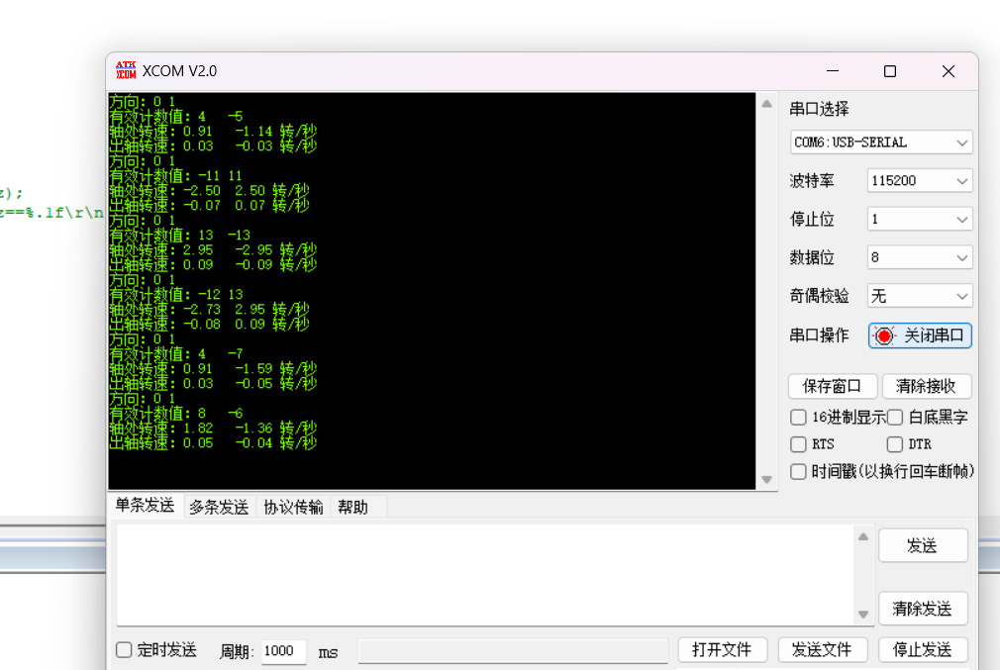
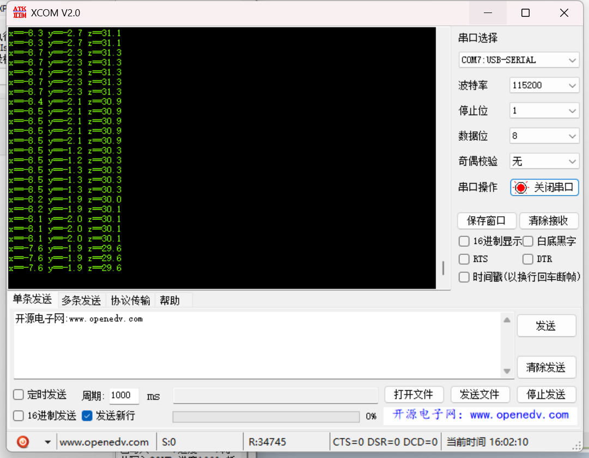

# 控制算法

## 1. 整体结构

平衡车采用 **串级 PID** 控制，三个环路分工明确：

```
                         ┌──────────────┐
   Target_Speed ───────→ │  速度环 (PI)  │──→ Velocity_out
   Encoder_Left  ──────↗ │              │    (角度补偿量)
   Encoder_Right ──────↗ └──────────────┘
                               │
                               ↓  Velocity_out + Med_Angle
                         ┌──────────────┐
                         │  直立环 (PD)  │──→ PWM_out
                  Pitch →│              │
                  gyroy →└──────────────┘
                               │
                               ↓  PWM_out
                   ┌───────────────────────────┐
                   │       ± Turn_out          │
                   │    ┌──────────────┐       │
            gyroz →│    │  转向环 (PD)  │       │
     Turn_Speed  →│    │              │       │
                   │    └──────────────┘       │
                   └───────────────────────────┘
                        ↓              ↓
                     MOTO1           MOTO2
                   (PWM - Turn)    (PWM + Turn)
```

**信号流**：速度环输出作为直立环的参考角度偏移 → 直立环输出基础 PWM → 转向环输出叠加差值 → 最终 PWM 送入电机。

## 2. 直立环 (PD)

### 公式

```
PWM_out = Kp × (Angle − Med) + Kd × (gyro_Y − 0)
```

### 参数

| 参数 | 值 | 说明 |
|------|----|------|
| Kp | 230 | 角度误差比例增益 |
| Kd | 0.6 | 角速度阻尼增益 |
| Med | 2.0 | 机械零点偏移（度） |

### 作用

维持车身直立。当 `Pitch` 偏离 `Med_Angle` 时输出纠正力矩，`gyroy` 提供微分阻尼消除震荡。

### 源码

```c
// control.c
int Vertical(float Med, float Angle, float gyro_Y)
{
    int PWM_out;
    PWM_out = Vertical_Kp * (Angle - Med) + Vertical_Kd * (gyro_Y - 0);
    return PWM_out;
}
```

## 3. 速度环 (PI)

### 公式

```
Encoder_Err = (encoder_left + encoder_right) − Target
EnC_Err_Lowout = (1−a) × Encoder_Err + a × EnC_Err_Lowout_last    // 一阶低通滤波
Encoder_S += EnC_Err_Lowout                                        // 积分
Encoder_S = clamp(Encoder_S, −10000, +10000)                       // 硬限幅
PWM_out = Kp × EnC_Err_Lowout + Ki × Encoder_S
```

### 参数

| 参数 | 值 | 说明 |
|------|----|------|
| Kp | −0.5 | 速度误差比例增益 |
| Ki | −0.0025 | 积分增益 (Kp/200) |
| a | 0.7 | 低通滤波系数 |

### 作用

控制车速趋向 `Target_Speed`。低通滤波抑制编码器噪声，积分消除稳态误差。输出作为直立环的角度补偿量。

### 源码

```c
// control.c
int Velocity(int Target, int encoder_left, int encoder_right)
{
    static int PWM_out, Encoder_Err, Encoder_S, EnC_Err_Lowout, EnC_Err_Lowout_last;
    float a = 0.7;

    Encoder_Err = ((encoder_left + encoder_right) - Target);
    EnC_Err_Lowout = (1-a)*Encoder_Err + a*EnC_Err_Lowout_last;
    EnC_Err_Lowout_last = EnC_Err_Lowout;
    Encoder_S += EnC_Err_Lowout;
    Encoder_S = Encoder_S>10000?10000:(Encoder_S<(-10000)?(-10000):Encoder_S);
    PWM_out = Velocity_Kp*EnC_Err_Lowout + Velocity_Ki*Encoder_S;

    return PWM_out;
}
```

## 4. 转向环 (PD)

### 公式

```
PWM_out = Kd × gyro_Z + Kp × RC
```

### 参数

| 参数 | 值 | 说明 |
|------|----|------|
| Kp | −20 | 转向指令比例增益 |
| Kd | −0.7 | 偏航角速度阻尼增益 |

### 作用

控制车体转向。`gyroz` 提供阻尼防止过冲，`RC`（即 `Turn_Speed`）是遥控转向指令。输出叠加到左右轮形成差值。

### 特殊行为

- 直行/停止时 `Turn_Kd = -0.7`（有阻尼）
- 左转/右转时 `Turn_Kd = 0`（无阻尼，转向更灵敏）

```c
// control.c - Control_Task 中
case CarBalance: Target_Speed = 0; Turn_Speed = 0; Turn_Kd = -0.7; break;
case CarFore:    Target_Speed++;   Turn_Kd = -0.7; break;
case CarBack:    Target_Speed--;   Turn_Kd = -0.7; break;
case CarLeft:    Turn_Speed++;     Turn_Kd = 0;    break;
case CarRight:   Turn_Speed--;     Turn_Kd = 0;    break;
```

## 5. 安全保护

| 机制 | 条件 | 动作 |
|------|------|------|
| 倾角保护 | `|Pitch| > 50°` | MOTO1=MOTO2=0，立即停转 |
| PWM 限幅 | 超过 ±7200 | `Limit()` 截断 |
| 速度限幅 | Target_Speed | 限幅 ±SPEED_X (10/15/20) |
| 转向限幅 | Turn_Speed | 限幅 ±80 |

## 6. 控制周期

`Control_Task` 设计周期为 **5ms**，由 SysTick 计数器 `Control_TIME` 触发。

## 7. 编码器反馈

### 读取方式

```c
// control.c - Control_Task
Encoder_Left  = -Read_Speed(ENCODER_A);   // A 轮取反，统一正方向
Encoder_Right =  Read_Speed(ENCODER_B);
```

`Read_Speed()` 读取 TIM 计数器当前值并清零，返回有符号值代表方向。

### 参数

| 参数 | 值 |
|------|----|
| 编码器线数 | 11 线 |
| 倍频 | 4 倍频 (TI12 模式) |
| 每转脉冲 | 44 |
| 减速比 | 1:34 |

## 8. 调参指南

### 8.1 调参顺序

```
1. 直立环 → 2. 速度环 → 3. 转向环 → 4. Med_Angle 微调
```

### 调试工具

串口实时输出编码器和姿态数据，方便调参时观察：

<p align="center">
  
</p>

<p align="center">
  
</p>

### 8.2 直立环

1. 设 `Kd=0`，逐渐增大 `Kp` 直到车能短暂直立
2. 加入 `Kd` 消除震荡
3. 当前值: `Kp=230, Kd=0.6`

| 现象 | 调整 |
|------|------|
| 站不起来，慢慢倒下 | Kp 太小，增大 |
| 站立但剧烈低频震荡 | Kp 太大或 Kd 太小 |
| 高频抖动/电机异响 | Kd 太大，减小 |
| 能站立但往前/后倒 | 正常，需要速度环 |

### 8.3 速度环

1. 直立环稳定后加入
2. 设 `Ki=0`，增大 `Kp` 直到能回到原点
3. 加入 `Ki` 消除稳态误差，建议 `Ki = Kp/200`
4. 当前值: `Kp=-0.5, Ki=-0.0025`

| 现象 | 调整 |
|------|------|
| 车慢慢漂移不回 | Kp 太小，增大 |
| 前后串动 | Kp 太大，减小 |
| 过冲后振荡 | Ki 太大，减小 |
| 静止时有稳态偏移 | Ki 太小，增大 |

### 8.4 转向环

1. 直立+速度环稳定后加入
2. 当前值: `Kp=-20, Kd=-0.7`

| 现象 | 调整 |
|------|------|
| 转向不灵敏 | Kp 绝对值太小 |
| 转向后回正振荡 | Kd 绝对值太小 |

### 8.5 Med_Angle 机械零点

- 默认值: `2.0`
- 如果车静止时持续向一个方向倒，微调此值
- 正值使车前倾，负值使车后仰
- 范围建议: −5.0 ~ +5.0
