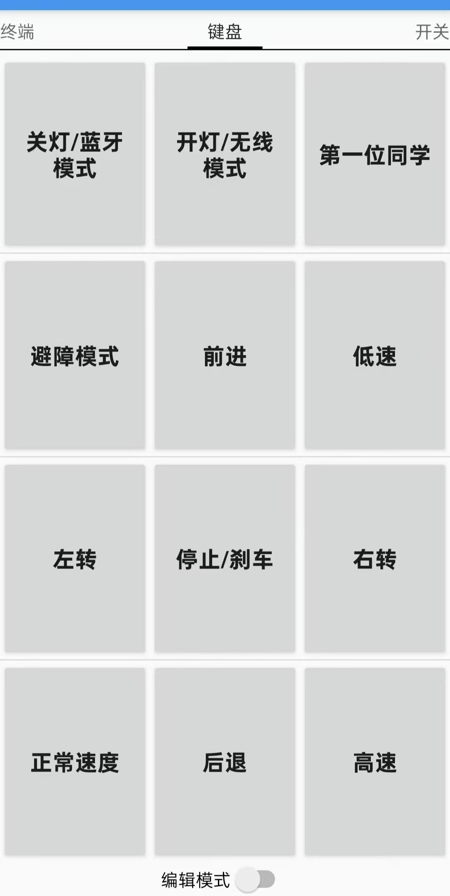

# 通信协议

## 1. 蓝牙协议 (USART2, 9600bps)

蓝牙模式下，手机 APP 通过 JDY-33 模块发送 **单字节指令**，车端在 `USART2_IRQHandler` 中接收，`Blue_count()` 中解析。

### 1.1 模式切换

手机 APP 界面：

<p align="center">
  
</p>

| 指令 | 模式 | OLED 显示 | LED1 | 说明 |
|------|------|-----------|------|------|
| 0x0D | 蓝牙模式 | LYMODE | 灭 | Cut_mode_flag = 0 |
| 0x0E | WiFi 模式 | WXMODE | 亮 | Cut_mode_flag = 1 |
| 0x11 | 避障模式 | BZMODE | - | Cut_mode_flag = 2 |

### 1.2 车体控制（仅蓝牙模式生效）

| 指令 | 动作 | CarDir |
|------|------|--------|
| 0x00 | 停止 | CarBalance |
| 0x01 | 前进 | CarFore |
| 0x02 | 后退 | CarBack |
| 0x03 | 右转 | CarRight |
| 0x04 | 左转 | CarLeft |

> ⚠️ 左右转定义与注释相反：代码中 0x03 设为 CarRight，0x04 设为 CarLeft

### 1.3 舵机控制（所有模式生效）

| 指令 | 动作 | SteerDir |
|------|------|----------|
| 0x05 | 停止 | SteerStop |
| 0x06 | 左转 | SteerLeft |
| 0x07 | 右转 | SteerRight |
| 0x08 | 上抬 | SteerUp |
| 0x09 | 下压 | SteerDown |

### 1.4 速度档位

| 指令 | 速度 | SPEED_X |
|------|------|---------|
| 0x0A | 低速 | 10 |
| 0x0B | 中速 | 15 |
| 0x0C | 高速 | 20 |

### 1.5 OLED 显示

| 指令 | 动作 |
|------|------|
| 0x14 | 显示开机图片 |
| 0x15 | 清屏 |

### 1.6 数据流

```
手机 APP → 蓝牙 → JDY-33 (USART2)
                         │
                         ↓
                   USART2_IRQHandler
                   ├─ 存入 Blue_buf[0]
                   └─ Blue_flag = 1 (IDLE 中断)
                         │
                         ↓  (30ms 周期)
                   Blue_count()
                   └─ switch(Blue_buf[0]) → 执行对应动作
```

## 2. WiFi 协议 (USART3, 9600bps)

WiFi 模式下，通过串口转 WiFi 模块透传数据。帧格式为 **6 字节固定长度帧**。

### 2.1 帧格式

```
┌──────┬──────┬──────┬──────┬──────┬──────┐
│ 0xAA │ 0x55 │ Cmd1 │ Cmd2 │ Cmd3 │ Chk  │
└──────┴──────┴──────┴──────┴──────┴──────┘
  帧头1  帧头2  车控制  舵机控制  速度   校验和
```

### 2.2 字段定义

**Cmd1 — 车体控制**

| 值 | 动作 |
|----|------|
| 0x00 | 停止 |
| 0x01 | 前进 |
| 0x02 | 后退 |
| 0x03 | 右转 |
| 0x04 | 左转 |

**Cmd2 — 舵机控制**

| 值 | 动作 |
|----|------|
| 0x05 | 停止 |
| 0x06 | 右转 |
| 0x07 | 左转 |
| 0x08 | 上抬 |
| 0x09 | 下压 |

> ⚠️ WiFi 模式下舵机方向映射与蓝牙模式相反：0x06=右转，0x07=左转

**Cmd3 — 速度档位**

| 值 | 速度 |
|----|------|
| 0x0A | 低速 (10) |
| 0x0B | 中速 (15) |
| 0x0C | 高速 (20) |

### 2.3 校验和

```
Chk = (Cmd1 + Cmd2 + Cmd3 + 0xAA + 0x55) & 0xFF
```

### 2.4 示例帧

**前进 + 舵机停止 + 中速：**
```
AA 55 01 05 0B 10
```

**左转 + 舵机上抬 + 低速：**
```
AA 55 04 08 0A 15
```

### 2.5 解析流程

```c
// wifi.c - WIFI_Analysis()
1. 检查 recvOver 标志
2. 检查 recvCount >= 6
3. 检查帧头 0xAA 0x55
4. 计算校验和并比对
5. 解析 Cmd1/Cmd2/Cmd3
6. 清空缓冲区，等待下一帧
```

## 3. 超声波协议 (HC-SR04)

### 3.1 触发时序

由 TIM5 定时中断驱动（周期 10μs）：

```
TIM5 中断 (每 10μs):
  sendCount = 1  → Trig 拉高 (PB4)
  sendCount = 3  → Trig 拉低 (产生 ≥20μs 脉冲)
  sendCount > 6000 → 重置 (≈60ms 周期)
```

### 3.2 回波测量

```
Echo 上升沿 (PB5, EXTI5)
  → recvCountFlag = 1
  → 开始计数

TIM5 中断:
  if(recvCountFlag == 1) recvCount++

Echo 下降沿
  → recvCountFlag = 0
  → 停止计数
```

### 3.3 距离计算

```
距离(cm) = recvCount × 34 / 200.0
```

**推导**：TIM5 每 10μs 计数一次 → 声速 340m/s = 0.034cm/μs → 往返距离 = 时间 × 0.034 / 2 = recvCount × 10μs × 0.034 / 2 = recvCount × 0.17cm。代码中使用 `34/200.0 = 0.17`，等价。

### 3.4 避障策略

```c
// sr04.c - Sr04_Mode()
if(10cm < 距离 < 30cm)
    CarDir = CarLeft;    // 左转避障
else
    CarDir = CarBalance; // 直行
```

| 距离 | 动作 |
|------|------|
| < 10cm | 直行（可能已检测到地面或盲区） |
| 10~30cm | 左转避障 |
| > 30cm | 直行 |
| > 400cm | 限幅为 380cm |

